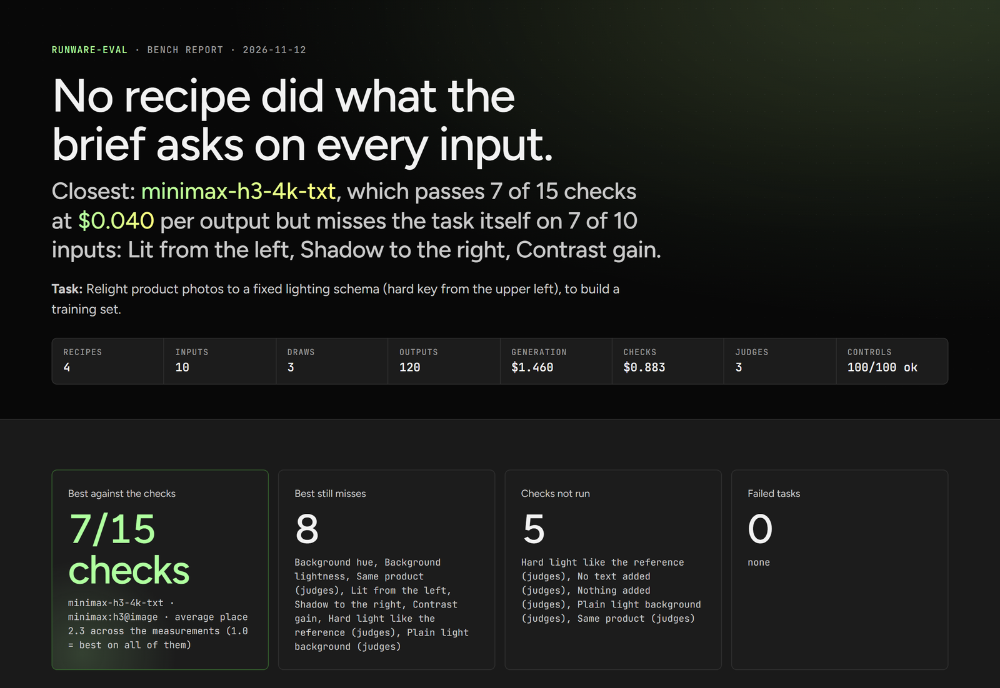

# runware-eval

**Which [Runware](https://runware.ai) model is best for *your* task?** runware-eval answers that with a
bench you can run again: your inputs, a set of recipes (model, settings, prompt, mask) and the checks
that measure your definition of good.



It is a skill for coding agents plus a Python runner. You describe what you are making. The agent
finds the candidate models, turns your brief into checks and writes a `bench.yaml`. The runner
generates under a budget cap, scores every output and hands you one HTML report.

```
/runware-eval Which model moves the key light on my product photos to the right without changing the product?
```

Or you can just ask for the best model for X task, and your agent will pick up the skill by itself if
it's installed.

## Contents

- [What it covers](#what-it-covers)
- [Install](#install)
- [Use](#use)
- [Runner commands](#runner-commands)
- [How it works](#how-it-works)
- [What it does not do](#what-it-does-not-do)
- [Repository layout](#repository-layout)
- [Tests](#tests)
- [License](#license)

## What it covers

Nine of the task types Runware's Model Router accepts, plus your own Serverless endpoints.

| Task type | The output | What the checks compare |
|---|---|---|
| `imageInference` | a picture | the picture against the input, its masks and any reference |
| `videoInference` | an MP4 | the first frame against the input, and the whole clip over time |
| `3dInference` | a GLB | the view that matches the input photo, and the mesh's own facts |
| `upscale` | a larger picture | the picture at the input's size and at its own, against a full-size original |
| `removeBackground` | a picture with transparency | its alpha against a reference outline |
| `imageMasking` | a black and white mask | the mask against a reference outline |
| `vectorize` | an SVG | the SVG rendered at the input's width, and the file itself |
| `caption` | text | the text, and the input picture for the judges |
| `textInference` | text | the text, and the input text for the judges |
| `serverlessEndpoint` | whatever your app returns | the same checks as the catalogue's models |

Cost, speed and failure rate are measured on every run.

## Install

**Claude Code** (plugin):

```
/plugin marketplace add risunobushi/runware-eval
/plugin install eval@runware-eval
```

`/runware-eval help` explains the skill and lists the runner commands.

**Any other agent with a shell:** copy `skills/runware-eval/` to where your agent loads skills
(`.claude/skills/`, `.cursor/skills/`, `.agents/skills/`).

**What the skill sets up on first use**, with no admin rights and no restart:

- the [Runware CLI](https://github.com/runware/runware-cli): catalogue, uploads and the one sign-in
  (`runware auth login`, in your own terminal; the key never goes through the chat);
- [uv](https://docs.astral.sh/uv/): runs the runner in its own environment on a pinned Python 3.12,
  which uv downloads if it is missing. Nothing is installed into your Python.

**Platforms.** Tested and working on Windows, macOS and Linux: setup on a clean machine (the agent
installs the Runware CLI and uv, and uv builds the runner's environment), the plugin install, the
`uvx` line and bench runs.

## Use

Ask your agent something like *"Which Runware model is best for adding a contact shadow without
changing my product?"* The skill will:

1. check the Runware CLI and uv, install what is missing, and ask you to sign in once;
2. ask what to evaluate (deviation, pixel shift, identity, text and brand, prompt adherence,
   aesthetics, technical quality), your budget and how many models to test;
3. take the brief apart into requirements and give each one a check, from the metric library or
   written for this bench, and show you the list to choose from;
4. find candidate models in the catalogue and read their schemas;
5. write `bench.yaml` and one file per recipe, and estimate the cost;
6. run a smoke round, then the full run, and hand you a single `report.html`.

## Runner commands

The agent runs these for you. From a clone of this repository:

```
uv run --project runner runware-eval <command> bench.yaml [--round smoke|full]
```

| Command | What it does |
|---|---|
| `estimate` | cost per recipe, each recipe's request checked against its model's schema, and models that changed since the last run. Nothing is paid. |
| `run --round smoke` | first input, first draw: a cheap look for broken recipes |
| `run --round full` | every input and draw; generates, scores and reports, and stops before passing the budget |
| `score` | scores saved results again (after a metric or a limit changed). No login needed. |
| `report [--notes notes.json]` | rebuilds the report from saved scores, with your findings and caveats |
| `calibrate --labels labels.json` | takes labels exported from the report: agreement with each check, and the limits that would agree better |
| `metrics list` / `plan` / `control` | the metrics this bench can use; the table of this bench's checks; the checks tested on unchanged inputs |
| `recipes list` / `extract` | recipe files with their fingerprints and past runs; move inline recipes into files |

Without cloning:

```
uvx --from "git+https://github.com/risunobushi/runware-eval#subdirectory=runner" runware-eval <command> bench.yaml
```

The first run builds the environment (about a minute); later runs reuse it. Dependencies are pinned
to exact versions (`runner/uv.lock`, covering Windows, macOS and Linux), so every machine gets the
same metric values.

## How it works

### Requirements and checks

A bench lists what the brief asks (`requirements`) and which checks answer each part.

- A requirement nothing measures stops a paid run: the agent writes a metric for it, or you leave it
  out on purpose.
- A requirement whose check has no limit is printed before the run.
- Both are shown in the report, so a hole in the bench is visible instead of missing from the standings.

Metrics are one file each. A library ships with the runner (`runner/runware_eval/metrics_lib/`, listed
in `skills/runware-eval/references/metric-catalog.md`), a bench adds its own in `metrics/`, and
`examples/metrics/` has four written for one bench. Every check is also run on an unchanged copy of
each input: a check that must pass there and fails, or the other way round, is at fault.

### How each output is read

- **Images** are scored directly against the input.
- **Videos** are read into frames. The first frame is compared with the input. Video checks (motion,
  frozen frames, scene changes, flicker, colour drift, texture stability, sharpness over time, black
  bars) read the whole clip. Product checks and the judges read five frames spread over it, each with
  its own product outline.
- **3D models** are rendered to the view that matches the input photo.
- **Cut-outs and masks** are compared with a reference outline; **SVGs** are rendered and their file
  read (shapes, nodes, embedded bitmaps).
- **Captions and text** are checked as text and by the judge panel.

### Limits

Nobody types a limit.

- **A yes/no requirement** is a question to a panel of three small vision models, and passes when
  most say yes.
- **A numeric check** gets its limit from the bench's first full run: the median of the recipes'
  results, moved towards "worse" by the larger of the spread between draws and the metric's smallest
  difference that counts.

There is no "nothing changed" baseline to hold a model to: encoding and decoding a picture already
changes it, and a closed model's round trip cannot be measured. So the typical result of real models
is the baseline. Limits are frozen in `limits.yaml` with a line on where each came from, and the
report lists them.

Two things can change a limit, both on your word:

- a number the brief states ("under 2 seconds") is written next to the check in `bench.yaml` and wins;
- your labels are a second opinion. The report and `calibrate` show how often each limit agreed with
  your eye and the value that would agree better, and apply nothing. If you accept one, the agent
  writes it to `limits.yaml` and notes that it came from you.

### The report

The report keeps three things apart.

- **Measured values** are the same for every user and every re-run.
- **The verdict** depends on the bench's limits, which are a judgement for one brief. Recipes are
  listed in this order: those that did the task first, then fewest failed checks, then best average
  place on the measurements, then lowest cost. The checks the best recipe still misses are named.
- **Your pick** appears once you have labeled outputs. It is your preference, shown beside the verdict
  and never applied to the bench. When the two disagree, the report says so.

**Labeling is in the report.** Under "Your labels" you mark outputs good or bad and pick the better of
random pairs, with recipe names hidden. Labels stay in your browser; agreement with each check, the
limit that would agree best and your own ranking are computed in the page as you click. "Export
labels.json" hands them to `runware-eval calibrate` or to a colleague, who can import them.

For video, the report plays two clips side by side on one clock and draws each per-frame measurement
over time.

### Draws

Each recipe runs `draws` times on each input (3 by default, 1 in the smoke round). No seed is sent
unless a recipe asks for one, so every draw is a new generation on the model's own random seed. A
check passes when it passes on most draws. Draws that come back as the very same file are called out
in the report.

### Spend

`budget.maxSpend` (USD for one full run) is required.

- A run does not start if the estimate passes the cap.
- While running, each task starts only if what is spent, what is in flight and its own estimate still fit.
- A recipe that costs more than estimated is reserved at its real cost from then on.
- Tasks that did not start are listed in the report; raise the cap and run again to fill them in.
- A recipe with no known price must state one (`price:` in its file, USD per output).

Results are cached per task, so running again only pays for what is new.

### Parameter check

Runware runs and bills a request that carries a field it does not know, at the model's default. So
before `estimate` and `run`, one request per recipe is validated against the model's published schema.

- **Stops the run, before anything is paid:** a field the model does not have (`widht`, with "did you
  mean `width`?"), or a value outside the allowed set or range.
- **Printed only:** a field the schema calls required, or a rule between fields, because the published
  schemas are sometimes stricter than the API.

`--skip-model-check` turns it off. It cannot see rules the API enforces and the schema does not state.

### Models that change

The same model id can change between two runs: status, price, a field, a default. Each run keeps what
Runware publishes about every model in `models.json` and stamps each result with it. The next run
prints what differs before spending (`status preview → live`, `price output: $0.0154 → $0.01926`,
`field added: ...`). Cached results from before a change are kept and marked in the report;
`run --regenerate-changed` makes them again. A model whose weights change while its schema, status and
price stay the same is not seen.

### Interrupted runs

Tasks are sent with Runware's async delivery and polled, so no connection is held open while a model
works. Every task is logged in `submitted.jsonl` before it is sent. Run the same command again and the
runner first asks Runware for the results of tasks already sent; one that is still running is not sent
a second time.

### Recipes

Recipes are one file each in `recipes/`, fingerprinted. Copy a file into another bench to share it;
matching past results (same fingerprint, same images, same draw) are reused instead of paid for.

### Model Router

A recipe with `model: auto` lets [Runware's Model Router](https://runware.ai/model-router) pick the
model, among the bench's models (`routing.allowedModels: bench`) or the whole catalogue, with your
weights and price ceiling. The router chooses from the request and never sees the output; the bench
measures what it produced. The report shows what it picked on each call, how those outputs did against
your checks, and how the same model did when called by name: use `auto` where its pick passes, and
call a model by name where it does not.

### Your own model

A recipe can call an endpoint of a Runware Serverless app (`taskType: serverlessEndpoint`), so a model
you trained or deployed is benchmarked next to the catalogue's, with the same checks and its cost per
output worked out from GPU seconds. Cold start and idle time are billed by Serverless and are not in
that figure. It was used to put a LoRA trained on Serverless back into the bench that picked its
teacher.

### How long it takes

Generation runs in parallel and is as fast as the models. Scoring reads every output at full size: a
small bench is scored in seconds to a couple of minutes, 100 or more outputs at 2048 px in tens of
minutes. The runner says so before a large run.

## What it does not do

- **Three Router task types are not covered:** audio, prompt enhancement and ControlNet preprocessing.
- **Training is out of scope.** The tool benchmarks a model you trained; the training side of the
  Serverless run (the app, its client, the dataset builder) is not in this repository.
- **One limit per check for the whole bench.** Limits set on one kind of input do not carry over to
  another kind, so a bench should hold inputs of one kind.
- **A winner holds for this bench only:** these inputs, these draws and these limits. The measured
  values are shared evidence; the verdict is a judgement you can change.

## Repository layout

```
skills/runware-eval/
  SKILL.md                    the agent's instructions
  references/                 bench.yaml format, how to choose metrics, the metric catalogue
runner/
  runware_eval/               the runner: estimate, run, score, report, calibrate
  runware_eval/metrics_lib/   the metric library, one file per metric
  tests/                      ten test files sharing tests/harness.py
examples/metrics/             four metrics written for one relighting bench
docs/                         the screenshot in this README
.claude-plugin/               the Claude Code plugin manifest
```

## Tests

Calls to Runware are stubbed, so no API key is needed and nothing is paid. Each file runs by itself:

```
cd runner
uv run python tests/test_limits.py
```

## License

[MIT](LICENSE)
